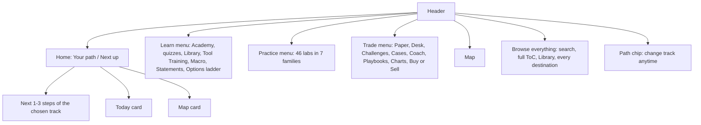

# Directional navigation: analysis and proposal

Status: approved by Weng on 2026-11-25 ("Just do it") and built the same day (header, path picker, Next up, Browse everything at `/browse`). Recommended answers to the open decisions below are the ones implemented. Companion to [`docs/NAVIGATION-INVENTORY.md`](../../NAVIGATION-INVENTORY.md), which lists every route, topic and deep link that must stay reachable.

## 1. How a learner reaches content today (before this change, commit `536eeb5`)

| Surface | What is on screen | Source |
|---|---|---|
| Header | 14 top-level controls (logo, 9 groups, label links plus chevrons) opening **82 menu items**; the Practice menu alone is one flat list of **46** labs | `src/components/AppChrome.tsx`, `src/lib/appNav.ts` |
| Home, first visit | Goal picker (3 paths), Continue, 5 optional coach and quiz links, **82 section pills** (`AppSectionNav`, every header item opened out), 6 quick links, account: about **100 body choices plus the header** | `src/pages/Dashboard.tsx` |
| Home, after picking a path | Adds Placement card, Today card (4 links), map card and the **embedded full progress map, one link per stage (179)**: **about 280 links** on one page | `Dashboard.tsx`, `ProgressMap.tsx` (`embedded`) |
| Table of Contents | 7 carousel groups; Quiz shows 41 or 66 group buttons; Deep Study panel alone holds **126 links** (99 coach sessions, 20 playbooks, 7 more) | `src/pages/Training.tsx` |
| "Next step" suggestions | Up to **5 competing "next" calls** on Home: path Continue, Today next unit, Placement, map card, map Next objective | Dashboard cards |

Guidance that already exists but does not steer the header or Home:

- **3 learning paths** (`src/lib/learningPaths.ts`): Beginner Equities, Decision Maker, Market Explorer. They are milestone spines for cases. Nobody can pick a path for charts, day trading, macro or options, and **once confirmed the path cannot be changed in the UI** (`GoalPicker` only renders while `pathConfirmed` is false).
- **Academy** L0–L7 with a 12-question placement (`src/lib/academy/placement.ts`) and the Today card.
- **Progress map**: 12 regions, 179 stages, a Next objective; it records visits and quiz results in `analysis_core_map_v1`.
- **Three separate session-only "peek" switches**: chart gate bypass, map Browse all, Academy browse all.
- No app-level tour; the `Walkthrough` popover is used in 4 labs only.

Click depth is fine (most pages are 2 clicks: menu, item). The problem is breadth: every surface shows everything, so a new learner gets no direction, and the 7 kinds of learner the content serves share one undifferentiated menu.

## 2. Learner types (tracks)

Derived from what the content serves. Each track is an ordered list of existing routes; steps with a progress map stage use the map's done status, the others count as done once visited. The data lives in `src/lib/tracks.ts`.

| Track | Who | Learning path it maps to (for case gating) |
|---|---|---|
| New to stocks | First-time learner | Beginner Equities |
| Charts and patterns | Wants to read candles and chart shapes | Beginner Equities |
| Active and day trading | Price action, opening range, intraday | Beginner Equities |
| Company fundamentals and earnings | Long-term investor | Decision Maker |
| Macro and news | Follows the economy and the Fed | Beginner Equities |
| Options and volatility | Calls, puts, income strategies, the VIX | Beginner Equities |
| Other markets | Futures, forex, crypto, commodities | Market Explorer |
| Show me everything | Returning or advanced learner | Decision Maker (shows all cases) |

#### 1. New to stocks (`new-to-stocks`)

First-time learner; no trading vocabulary yet.

| # | Step | Opens | Progress map stage |
|---:|---|---|---|
| 1 | Placement check or “I'm brand new” | `/academy` | — |
| 2 | Academy L0 Orientation (5 units) | `/academy` | `academy:L0` |
| 3 | Academy L1 Stock basics | `/academy` | `academy:L1` |
| 4 | Equities literacy quiz | `/training?group=equity-literacy` | `quiz:equity-literacy` |
| 5 | Candlestick Basics | `/practice/candle-basics` | `page:/practice/candle-basics` |
| 6 | Candle anatomy quiz | `/training?group=candle-anatomy` | `quiz:candle-anatomy` |
| 7 | Academy L2 Charts & candles | `/academy` | `academy:L2` |
| 8 | Indicators quiz (opens graded cases) | `/training?group=indicators` | `quiz:indicators` |
| 9 | Academy L3 Orders, sizing & risk | `/academy` | `academy:L3` |
| 10 | First paper trade (coach) | `/coach/first-paper-trade` | — |
| 11 | Paper account | `/paper` | `page:/paper` |
| 12 | Challenge: Protect every entry | `/paper/challenges/protect-with-a-stop` | — |
| 13 | Statements literacy quiz | `/training?group=financial-literacy` | `quiz:financial-literacy` |
| 14 | Earnings cases (beginner) | `/cases?pack=earnings` | — |
| 15 | Company news cases | `/cases?pack=company-news` | — |

#### 2. Charts and patterns (`charts-patterns`)

Wants to read candles and chart shapes.

| # | Step | Opens | Progress map stage |
|---:|---|---|---|
| 1 | Candlestick Basics | `/practice/candle-basics` | `page:/practice/candle-basics` |
| 2 | Candle anatomy, then candle reading quizzes | `/training?group=candle-reading` | `quiz:candle-reading` |
| 3 | Japanese candlesticks | `/practice/japanese-candles` | `lab:japanese-candles` |
| 4 | Essential candlestick patterns | `/practice/essential-candles` | `lab:essential-candles` |
| 5 | Missing wicks and zooming in | `/practice/missing-wicks` | `lab:missing-wicks` |
| 6 | Which Way? | `/practice/which-way` | `lab:which-way` |
| 7 | Candle pattern book quiz | `/training?group=candle-pattern-book` | `quiz:candle-pattern-book` |
| 8 | Pattern themes | `/practice/pattern-themes` | `lab:pattern-themes` |
| 9 | Reversal chart patterns | `/practice/reversal-charts` | `lab:reversal-charts` |
| 10 | Chart patterns quiz | `/training?group=chart-patterns` | `quiz:chart-patterns` |
| 11 | Flashcards, Label, Lookalikes, Pattern hunt, Drawing | `/practice/hunt` | `lab:hunt` |
| 12 | Trend vs range; Support and resistance | `/practice/levels` | `lab:levels` |
| 13 | Indicators quiz; EMA/SMA/MACD; Oscillators | `/practice/ema-macd` | `lab:ema-macd` |
| 14 | Heikin-Ashi candles | `/practice/heikin-ashi` | `lab:heikin-ashi` |
| 15 | Library: patterns tab | `/archive` | `page:/archive` |

#### 3. Active and day trading (`active-trader`)

Price action, opening range, intraday execution.

| # | Step | Opens | Progress map stage |
|---:|---|---|---|
| 1 | Price action trading framework | `/practice/trade-framework` | `lab:trade-framework` |
| 2 | Four pillars quiz | `/training?group=four-pillars` | `quiz:four-pillars` |
| 3 | Support and resistance | `/practice/levels` | `lab:levels` |
| 4 | Opening range lab | `/practice/opening-range` | `lab:opening-range` |
| 5 | Playbook: Opening range context and confirmation | `/playbooks/orb-context-confirmation` | — |
| 6 | Coach: Opening range breakout | `/coach/opening-range-breakout` | — |
| 7 | Breakout, pullback and fair value gap | `/practice/fair-value-gap` | `lab:fair-value-gap` |
| 8 | Reading 1-minute charts | `/practice/one-minute-charts` | `lab:one-minute-charts` |
| 9 | Fibonacci as a decision map | `/practice/fib-decision-map` | `lab:fib-decision-map` |
| 10 | Bar replay, Mark the plan, Invalidation | `/practice/invalidation` | `lab:invalidation` |
| 11 | Playbooks: Gap and go, VWAP hold, EMA reclaim | `/playbooks/gap-and-go` | — |
| 12 | Price action cases | `/cases?pack=price-action` | — |
| 13 | Paper desk: Breakouts & gaps, Execution & risk topics | `/paper/desk` | — |
| 14 | Challenges: Breakout buy stop, Gap through stop | `/paper/challenges/breakout-buy-stop` | — |
| 15 | Trading risk quiz | `/training?group=trading-risk` | `quiz:trading-risk` |

#### 4. Company fundamentals and earnings (`fundamentals`)

Long-term investor who reads statements and earnings.

| # | Step | Opens | Progress map stage |
|---:|---|---|---|
| 1 | Academy L4 Company fundamentals & earnings | `/academy` | `academy:L4` |
| 2 | Statements literacy quiz | `/training?group=financial-literacy` | `quiz:financial-literacy` |
| 3 | Statements lab | `/practice/statements` | `page:/practice/statements` |
| 4 | Reading the statements quiz | `/training?group=statements-reading` | `quiz:statements-reading` |
| 5 | 13-week cash forecast quiz | `/training?group=cash-forecast-13wk` | `quiz:cash-forecast-13wk` |
| 6 | Earnings preview quiz | `/training?group=earnings-preview` | `quiz:earnings-preview` |
| 7 | Read the Print | `/practice/read-the-print` | `page:/practice/read-the-print` |
| 8 | Mark the band | `/practice/mark-the-band` | `page:/practice/mark-the-band` |
| 9 | Earnings desk language quiz | `/training?group=earnings-jargon` | `quiz:earnings-jargon` |
| 10 | Tool Training: StockAnalysis, SEC EDGAR, Earnings & insiders | `/tools/sec-edgar` | — |
| 11 | Earnings, company news, then news plus financials cases | `/cases?pack=combined` | — |
| 12 | Paper desk: Earnings & guidance, Balance-sheet risk, Insiders & analysts | `/paper/desk` | — |
| 13 | Playbooks: Dollar-cost averaging, Rebalance to target | `/playbooks/rebalance-to-target` | — |

#### 5. Macro and news (`macro-news`)

Follows the economy, the Fed and headlines.

| # | Step | Opens | Progress map stage |
|---:|---|---|---|
| 1 | Academy L5 Macro & rates | `/academy` | `academy:L5` |
| 2 | News literacy quiz | `/training?group=news-literacy` | `quiz:news-literacy` |
| 3 | Macro Desk lessons (jobs, CPI, FOMC, curve…) | `/macro` | `hub:macro` |
| 4 | Macro releases, rates curve, Fed policy quizzes | `/training?group=fed-policy` | `quiz:fed-policy` |
| 5 | Macro play (29 rounds) | `/macro/play` | `page:/macro/play` |
| 6 | Macro reactions quiz | `/training?group=macro-reactions` | `quiz:macro-reactions` |
| 7 | Tool Training: Market Forces | `/tools/market-forces` | — |
| 8 | News, biases & short-term options | `/practice/news-biases` | `lab:news-biases` |
| 9 | Market-wide news cases | `/cases?pack=macro-news` | — |
| 10 | Bonds and rates; Sectors and rotation themes | `/practice/sectors-rotation` | `lab:sectors-rotation` |
| 11 | Paper desk: Macro & sectors topic | `/paper/desk` | — |
| 12 | Playbooks: Business-cycle sector tilt, Treasury bond ladder | `/playbooks/business-cycle-sector-tilt` | — |

#### 6. Options and volatility (`options-vol`)

Wants calls, puts, income strategies and the VIX.

| # | Step | Opens | Progress map stage |
|---:|---|---|---|
| 1 | Academy L6 Options education (test-out first if ready) | `/academy` | `academy:L6` |
| 2 | Options literacy quiz | `/training?group=options-literacy` | `quiz:options-literacy` |
| 3 | Options ladder | `/academy/options` | `page:/academy/options` |
| 4 | Options ladder quiz | `/training?group=options-ladder` | `quiz:options-ladder` |
| 5 | Futures vs options & beginner toolkit | `/practice/futures-vs-options` | `lab:futures-vs-options` |
| 6 | Playbooks: Covered call, Cash-secured put, Protective put | `/playbooks/covered-call` | — |
| 7 | The wheel strategy | `/practice/wheel-strategy` | `lab:wheel-strategy` |
| 8 | Gamma squeeze case; Squeezes quiz | `/practice/gamma-squeeze` | `lab:gamma-squeeze` |
| 9 | VIX trading for beginners | `/practice/vix-trading` | `lab:vix-trading` |
| 10 | Risk-premium portfolio and the VIX overlay | `/practice/risk-premium-portfolio` | `lab:risk-premium-portfolio` |
| 11 | Options context cases | `/cases?pack=options-context` | — |
| 12 | Paper desk: time decay scenario | `/paper/desk` | — |

#### 7. Other markets (`other-markets`)

Futures, forex, crypto and commodities (extends today's Market Explorer path).

| # | Step | Opens | Progress map stage |
|---:|---|---|---|
| 1 | Indicators quiz (chart gate) | `/training?group=indicators` | `quiz:indicators` |
| 2 | Academy L7 Other markets | `/academy` | `academy:L7` |
| 3 | Futures, forex, crypto literacy quizzes | `/training?group=futures-literacy` | `quiz:futures-literacy` |
| 4 | Same theme, different wrapper | `/practice/exposure-wrappers` | `lab:exposure-wrappers` |
| 5 | Futures cases | `/cases?pack=futures` | — |
| 6 | Playbook: Futures roll | `/playbooks/futures-roll` | — |
| 7 | Forex cases | `/cases?pack=forex` | — |
| 8 | Candlesticks for crypto | `/practice/crypto-candles` | `lab:crypto-candles` |
| 9 | Crypto cases | `/cases?pack=crypto` | — |
| 10 | Market themes: precious metals, energy, agriculture, industrial metals… | `/practice/energy` | `lab:energy` |

## 3. Proposed navigation

- **Path picker** on the first Home visit: 8 cards (7 tracks plus Show me everything), one click, saved in `localStorage` (`analysis_core_track_v1`). Changeable anytime from the header path chip. Picking a track for the first time also confirms the mapped learning path, so the old goal picker no longer appears; changing track later never resets progress.
- **Home** shows only the track's next 1–3 steps, the Today card, the map card and the existing milestone spine (collapsed). The 82 pills and the embedded 179-stage map move off Home (the pills to Browse everything, the full map stays at `/map`).
- **Header**: Home, Learn, Practice, Trade, Map, Browse everything, plus the path chip: 7 controls instead of 14, and every one of the 82 old items is still in a menu or on Browse everything.
- **Browse everything** (`/browse`): search across quiz groups, labs, Academy units, test-outs, macro lessons, coach sessions, playbooks, case packs, challenges, glossary terms and patterns; links to the full Table of Contents and the Library; every old menu item grouped; and explicit lists for the at-risk items.

### Old entry point → new

| Old | New |
|---|---|
| Dashboard menu → Map | Header Map |
| ToC label | Browse everything → Full Table of Contents (`/training` unchanged) |
| Academy menu (Lessons, Quiz Concepts) | Learn menu |
| Pattern recognition menu (Candlestick Basics, Quiz Patterns, Library) | Learn menu |
| Practice menu (46, flat) | Practice menu (46, grouped in 7 families, plus Statements lab, Read the Print, Mark the band) |
| Tool Training menu (10) | Learn → Tool Training; every lesson on Browse everything |
| Deep Study menu (Cases, Coach, Playbooks, Paper, Paper desk, Challenges) | Trade menu |
| Other factors menu (Financials, Statements lab, Read the Print, Mark the band, Macro, Macro desk, Macro play) | Learn (Macro desk, Statements lab), Practice (Read the Print, Mark the band), Trade (Macro play); all on Browse everything |
| Quick Decisions (Charts, Buy or Sell) | Trade menu |
| Home section pills (82) | Browse everything |

### At-risk items from the inventory

| Item | New entry points |
|---|---|
| 8 Academy test-outs (one hub link only) | Browse everything lists L0–L7 test-outs; search finds them |
| 18 macro lessons | Browse everything lists all; Macro track; search |
| 68 coach sessions hidden by the equity filter | Browse everything links the coach hub per market (`/coach?class=…`); search finds every session |
| Cases (517) | Browse everything lists all 17 packs; tracks link packs |
| 10 challenges | Browse everything lists all; tracks link two |
| Paper desk, coach and playbooks hubs not in the ToC | Trade menu, and the ToC Deep Study panel now links them |
| Map in one menu | Header Map |

### Deep links

No route, hash or param changes. `/training` and its hashes, `?group=`/`&start=1`, `/archive?tab=&open=`, `?pack=`, `?round=`, `?sim=`, `?check=1` all keep working; one route is added (`/browse`). The `navInventory` guard now reads its entry points from the new header data and the Browse everything catalog, and also checks that every track step resolves to a real route.

## 4. Phases

1. **Done in this change** (about 2 days): tracks, picker, Next up, collapsed header, Browse everything with search, ToC links for the at-risk hubs, tests and docs.
2. **Next** (2–3 days): filter the progress map by track; deep link one paper desk scenario (`?scenario=`) and one options ladder strategy so tracks can point at them.
3. **Later** (1–2 days): one "Browse everything" switch that turns on the three session peeks together; per-track completion badges.

## 5. Decisions taken (recommendations implemented)

1. **Seven tracks plus Show me everything**, mapped onto the 3 existing learning paths rather than replacing them.
2. **Header: Home, Learn, Practice, Trade, Map, Browse everything**, plus a path chip.
3. **Ask once on first visit, never force it**: the picker is an inline Home panel, not a blocking modal, and Show me everything is one of the choices.
4. **Changing track never resets progress**: the track is stored apart from the milestone path.
5. **Gates stay as they are**: Browse everything shows every link, while the chart gate and Academy locks keep their existing session peeks (phase 3 may merge them).
